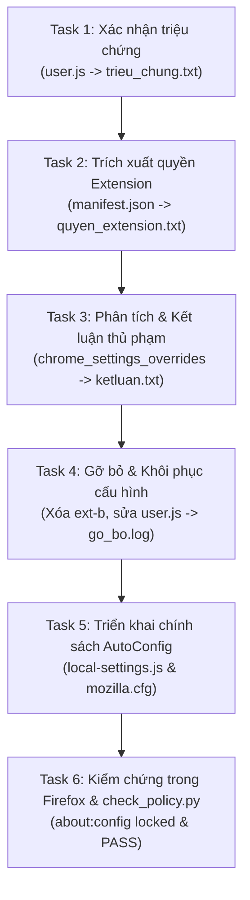

# BÁO CÁO XÂY DỰNG BÀI LAB LABTAINER: BROWSER-HIJACK-DEFENSE
**Phòng thủ và Khôi phục Sự cố Trình duyệt bị Hijack bằng Mozilla AutoConfig**

---

## 1. GIỚI THIỆU

### 1.1. Bối cảnh
Browser Hijacking (Chiếm quyền điều khiển trình duyệt) là một hình thức tấn công mạng phổ biến trong môi trường doanh nghiệp. Kẻ tấn công thường lừa người dùng cài đặt các tiện ích mở rộng (Browser Extension) độc hại hoặc lợi dụng phần mềm không rõ nguồn gốc để ghi đè các cấu hình nhạy cảm của trình duyệt, bao gồm:
- Thay đổi trang chủ (Homepage) mặc định sang các trang web quảng cáo, chứa mã độc hoặc lừa đảo.
- Chuyển hướng công cụ tìm kiếm mặc định (Default Search Engine) sang công cụ tìm kiếm giả mạo nhằm thu thập dữ liệu truy vấn của người dùng.
- Chiếm đoạt lưu lượng duyệt web, hiển thị quảng cáo rác và theo dõi lịch sử duyệt web.

Tại tập đoàn giả định **NovaCorp**, một nhân viên văn phòng báo cáo máy trạm `workstation` gặp hiện tượng bất thường: mỗi khi khởi động trình duyệt Firefox, trang chủ tự động mở ra trang quảng cáo `http://ads.local:8080/` và công cụ tìm kiếm bị đổi sang `AdsSearch`. Đội ngũ ứng cứu sự cố CSIRT đã cô lập 3 extension nghi vấn trên máy tại thư mục `~/incident/extensions/` để điều tra.

### 1.2. Mục tiêu bài lab
- Trang bị cho sinh viên kỹ năng phân tích tĩnh các tiện ích mở rộng của trình duyệt thông qua file khai báo `manifest.json`.
- Phân biệt các quyền hạn thông thường và quyền hạn có khả năng can thiệp cấu hình trình duyệt (`chrome_settings_overrides`, `host_permissions`).
- Rèn luyện kỹ năng điều tra, gỡ bỏ thành phần độc hại và khôi phục file cấu hình profile `user.js`.
- Làm chủ cơ chế quản trị chính sách bảo mật tập trung của Mozilla (**Mozilla AutoConfig** với `local-settings.js` và `mozilla.cfg`) nhằm khóa cứng cấu hình trang chủ, công cụ tìm kiếm và **chặn hoàn toàn việc cài đặt extension mới** (`xpinstall.enabled = false`).

---

## 2. NỘI DUNG VÀ HƯỚNG DẪN THỰC HIỆN

### 2.1. Kịch bản tổng thể
Sinh viên vào vai Kỹ sư An toàn thông tin của NovaCorp, thực hiện chuỗi 6 nhiệm vụ liên tiếp trên máy trạm `workstation`:



### 2.2. Hướng dẫn chi tiết từng nhiệm vụ

#### Task 1: Xác nhận triệu chứng
1. Kiểm tra file `~/.mozilla/firefox/default/user.js`:
   ```bash
   cat ~/.mozilla/firefox/default/user.js
   ```
2. Ghi nhận URL trang chủ và search engine bị thay đổi vào file `~/incident/trieu_chung.txt`:
   ```bash
   echo "Trang chu bi doi thanh: http://ads.local:8080/" > ~/incident/trieu_chung.txt
   echo "Search engine bi doi thanh: AdsSearch" >> ~/incident/trieu_chung.txt
   ```

#### Task 2: Trích xuất quyền hạn của 3 extension nghi vấn
1. Sử dụng lệnh xem và trích xuất các trường `permissions`, `host_permissions`, `chrome_settings_overrides` từ file `manifest.json` của 3 extension (`ext-a`, `ext-b`, `ext-c`):
   ```bash
   python3 -c '
   import json, glob
   for p in sorted(glob.glob("/home/ubuntu/incident/extensions/*/manifest.json")):
       with open(p) as f:
           d = json.load(f)
       print("=== Extension:", p.split("/")[-2], "===")
       print("permissions:", d.get("permissions"))
       print("host_permissions:", d.get("host_permissions"))
       print("chrome_settings_overrides:", d.get("chrome_settings_overrides"))
   ' > ~/incident/quyen_extension.txt
   ```

#### Task 3: Phân tích và kết luận thủ phạm
1. Phân tích kết quả:
   - `ext-a`: Chỉ có quyền `storage` -> Tiện ích ghi chú thông thường, vô hại.
   - `ext-c`: Có quyền `tabs`, `history` -> Đáng ngờ nhưng không có cấu hình can thiệp cài đặt trình duyệt.
   - `ext-b`: Chứa trường `chrome_settings_overrides` thiết lập `homepage` thành `http://ads.local:8080/` và `search_provider` thành `AdsSearch`, kèm `host_permissions: ["<all_urls>"]` -> Đây chính là thủ phạm Browser Hijacker!
2. Ghi kết luận và phân tích kỹ thuật vào `~/incident/ketluan.txt`:
   ```bash
   echo "Thủ phạm: ext-b" > ~/incident/ketluan.txt
   echo "Lý do: ext-b chứa trường chrome_settings_overrides ghi đè trang chủ về http://ads.local:8080/ và search provider về AdsSearch." >> ~/incident/ketluan.txt
   ```

#### Task 4: Gỡ bỏ và khôi phục cấu hình
1. Xóa thư mục extension độc hại `ext-b`:
   ```bash
   rm -rf ~/incident/extensions/ext-b
   ```
2. Chỉnh sửa `~/.mozilla/firefox/default/user.js`, xoá 2 dòng bị nhiễm:
   ```bash
   > ~/.mozilla/firefox/default/user.js
   ```
3. Ghi log xử lý vào `~/incident/go_bo.log`:
   ```bash
   echo "Da go bo hoan toan ext-b va lam sach user.js" > ~/incident/go_bo.log
   ```

#### Task 5: Triển khai chính sách doanh nghiệp bằng Mozilla AutoConfig
1. Tạo file trỏ cấu hình `/usr/lib/firefox/defaults/pref/local-settings.js` (dùng `sudo`):
   ```bash
   sudo mkdir -p /usr/lib/firefox/defaults/pref
   sudo tee /usr/lib/firefox/defaults/pref/local-settings.js << 'EOF'
   pref("general.config.obscure_value", 0);
   pref("general.config.filename", "mozilla.cfg");
   EOF
   ```
2. Tạo file chính sách `/usr/lib/firefox/mozilla.cfg` (Dòng 1 bắt buộc là comment `//`):
   ```bash
   sudo tee /usr/lib/firefox/mozilla.cfg << 'EOF'
   // Chinh sach bao mat trinh duyet NovaCorp Enterprise
   lockPref("browser.startup.homepage", "http://novacorp.local:8080/");
   lockPref("browser.startup.page", 1);
   lockPref("browser.search.defaultenginename", "NovaSearch");
   lockPref("xpinstall.enabled", false);
   EOF
   ```
   *Lưu ý: `lockPref("xpinstall.enabled", false);` có tác dụng khóa cứng và chặn hoàn toàn việc cài đặt extension mới vào trình duyệt.*

#### Task 6: Kiểm chứng chính sách bảo mật
1. Khởi động lại Firefox trên giao diện đồ họa. Trình duyệt tự động mở cổng thông tin nội bộ `http://novacorp.local:8080/`.
2. Mở tab `about:config`, tìm `browser.startup.homepage` và `xpinstall.enabled`: xác nhận trạng thái là **locked** (chữ in đậm).
3. Chạy script kiểm tra tự động:
   ```bash
   ./check_policy.py
   ```
   Nếu tất cả cấu hình đạt chuẩn, màn hình in ra `PASS`.

---

## 3. PHÂN TÍCH YÊU CẦU

### 3.1. Yêu cầu chức năng
1. **Môi trường giả lập:** 
   - 1 container duy nhất mang tên `workstation` chạy hệ điều hành Linux với trình duyệt Mozilla Firefox.
   - Mock HTTP Server chạy nền cổng 8080 phục vụ cả 2 domain `ads.local:8080` (trang quảng cáo) và `novacorp.local:8080` (trang chủ công ty an toàn).
2. **Tính năng phân tích tĩnh:**
   - 3 extension mẫu chỉ chứa file `manifest.json`, tuyệt đối không chứa mã JavaScript thực thi độc hại để đảm bảo an toàn tuyệt đối.
3. **Cơ chế chính sách chuẩn:**
   - Sử dụng cơ chế Mozilla AutoConfig chuẩn (`local-settings.js` và `mozilla.cfg`) hỗ trợ trên mọi bản phân phối Firefox Release/ESR mà không cần can thiệp binary.

### 3.2. Yêu cầu phi chức năng và chống gian lận
- **Không in mật khẩu/token ra file:** Mật khẩu tài khoản `ubuntu` là `ubuntu`, chỉ dùng tương tác dòng lệnh sudo, không nhúng vào bất kỳ script kiểm tra nào.
- **Tính xác thực của r_verify:** Điểm số của Task 6 bắt buộc phải dựa trên việc sinh viên thực sự chạy lệnh `./check_policy.py`. Labtainers giám sát việc chạy lệnh thông qua cơ chế `treataslocal` và daemon `capinout` ghi log stdout kèm timestamp. Sinh viên không thể tự gõ `PASS` vào một file văn bản để gian lận.

---

## 4. THIẾT KẾ HỆ THỐNG VÀ ĐÁNH GIÁ (ASSESSMENT)

### 4.1. Kiến trúc lab
- **Container `workstation`:** Chứa toàn bộ môi trường phân tích, hồ sơ sự cố (`~/incident/`), profile Firefox (`~/.mozilla/firefox/default/`) và mock web server cổng 8080.
- **Dịch vụ mạng nội bộ:** `/etc/hosts` phân giải `ads.local` và `novacorp.local` về IP loopback `127.0.0.1`.

### 4.2. Bảng ánh xạ kết quả đánh giá (Results Table)

| Tên Result (`results.config`) | Vị trí kiểm tra / Lệnh | Toán tử | Giá trị so khớp | Ý nghĩa đánh giá |
|:---|:---|:---:|:---|:---|
| `r_trieuchung` | `workstation:incident/trieu_chung.txt` | `CONTAINS` | `ads.local:8080` | Xác nhận triệu chứng trình duyệt bị đổi sang trang quảng cáo lạ. |
| `r_quyen` | `workstation:incident/quyen_extension.txt` | `CONTAINS` | `chrome_settings_overrides` | Sinh viên đã đọc và trích xuất đúng trường can thiệp cấu hình trình duyệt. |
| `r_ketluan` | `workstation:incident/ketluan.txt` | `CONTAINS` | `ext-b` | Xác định đúng extension `ext-b` là thủ phạm gây ra sự cố. |
| `r_gobo` | `workstation:incident/go_bo.log` | `CONTAINS` | `ext-b` | Ghi nhận hành động gỡ bỏ extension thủ phạm khỏi máy trạm. |
| `r_policy` | `workstation:/usr/lib/firefox/mozilla.cfg` | `CONTAINS` | `lockPref("browser.startup.homepage", "http://novacorp.local:8080/")` | Triển khai thành công chính sách khóa trang chủ công ty bằng AutoConfig. |
| `r_verify` | `workstation:check_policy.py.stdout` | `CONTAINS` | `PASS` | Script kiểm tra tự động xác nhận toàn bộ chính sách có hiệu lực và in `PASS`. |

### 4.3. Bảng mục tiêu đánh giá (Goals Table)

| Tên Goal (`goals.config`) | Biểu thức Logic | Mục tiêu đào tạo |
|:---|:---:|:---|
| `g_trieuchung` | `boolean : r_trieuchung` | Phát hiện và ghi nhận dấu hiệu bất thường của profile trình duyệt. |
| `g_quyen` | `boolean : r_quyen` | Phân tích quyền hạn của các WebExtensions trong file `manifest.json`. |
| `g_ketluan` | `boolean : r_ketluan` | Kỹ năng tổng hợp chứng cứ và xác định đúng phần mềm độc hại. |
| `g_gobo` | `boolean : r_gobo` | Xử lý triệt để thành phần độc hại và làm sạch profile bị nhiễm. |
| `g_policy` | `boolean : r_policy` | Thiết lập chính sách bảo mật doanh nghiệp thông qua Mozilla AutoConfig. |
| `g_verify` | `boolean : r_verify` | Kiểm chứng thực tế hiệu lực của chính sách trên hệ thống. |

---

## 5. CÀI ĐẶT VÀ CẤU HÌNH CHI TIẾT

### 5.1. File `start.config`
```ini
    GLOBAL_SETTINGS
    LAB_MASTER_SEED browser-hijack-defense_mike_master_seed
CONTAINER workstation
     USER ubuntu
     PASSWORD ubuntu
     X11 YES
```

### 5.2. File `Dockerfile.browser-hijack-defense.workstation.student`
```dockerfile
ARG registry
FROM $registry/labtainer.firefox
ARG lab
ARG labdir
ARG imagedir
ARG user_name
ARG password
ARG apt_source

USER root
# Cấu hình apt mirror và cài đặt curl
RUN sed -i 's/ubuntumirror.uc.nps.edu/archive.ubuntu.com/g' /etc/apt/sources.list && \
    apt-get update && apt-get install -y --no-install-recommends curl && \
    apt-get clean && rm -rf /var/lib/apt/lists/*

# Tạo user sinh viên và cấu hình sudo
RUN if ! id -u $user_name >/dev/null 2>&1; then \
        useradd -ms /bin/bash -u 1000 $user_name && \
        echo "$user_name:$password" | chpasswd && \
        adduser $user_name sudo; \
    fi

ENV HOME=/home/$user_name

ADD $labdir/$lab.tar.gz $HOME
ADD $labdir/sys_$lab.tar.gz /

RUN chown -R $user_name:$user_name $HOME
```

### 5.3. Khởi động dịch vụ nền (`workstation/_bin/fixlocal.sh`)
```bash
#!/bin/bash
# fixlocal.sh - Chạy khi container khởi động, đảm bảo mock_server.py chỉ chạy 1 lần duy nhất
if ! pgrep -f "mock_server.py" > /dev/null; then
    nohup python3 /home/ubuntu/srv/mock_server.py > /home/ubuntu/srv/mock_server.log 2>&1 &
fi
```

### 5.4. Khai báo giám sát lệnh (`workstation/_bin/treataslocal`)
```
check_policy.py
```

### 5.5. Script tự động đánh giá (`workstation/bin/check_policy.py`)
Script kiểm tra đồng thời:
1. `local-settings.js` có tồn tại và nạp `mozilla.cfg`.
2. `mozilla.cfg` có dòng comment đầu tiên, có `lockPref` cho homepage `http://novacorp.local:8080/`, `browser.search.defaultenginename`, và `xpinstall.enabled = false`.
3. Profile `user.js` đã sạch dấu vết `ads.local:8080`.
4. In ra `PASS` nếu hoàn thành toàn bộ, ngược lại in `FAIL`.

---

## 6. TÍCH HỢP VÀ TRIỂN KHAI

### 6.1. Quy trình đóng gói và Rebuild Labtainers
Để kiểm tra tính hợp lệ của bài lab, sử dụng công cụ chuẩn của Labtainers:
1. Kiểm tra cấu hình và cú pháp:
   ```bash
   cd ~/labtainer/trunk/scripts/labtainer-instructor/bin
   ./validate.py browser-hijack-defense
   ```
2. Đóng gói và build container image thông qua `rebuild`:
   ```bash
   cd ~/labtainer/trunk/scripts/labtainer-student/bin
   ./rebuild.py browser-hijack-defense -f
   ```

### 6.2. Triển khai Docker Hub
Image sau khi build được tag và đưa lên Docker Hub registry của Labtainers:
```bash
docker tag browser-hijack-defense.workstation.student labtainers/browser-hijack-defense.workstation.student:latest
docker push labtainers/browser-hijack-defense.workstation.student:latest
```

### 6.3. Quản lý mã nguồn qua GitHub
Toàn bộ mã nguồn bài lab và gói phân phối `imodule_browser-hijack-defense.tar` được lưu trữ công khai tại GitHub:
- **Địa chỉ kho lưu trữ**: [https://github.com/Huan-0808/browser-hijack-defense-lab](https://github.com/Huan-0808/browser-hijack-defense-lab)
- **Link tải trực tiếp file `imodule_browser-hijack-defense.tar`**: [https://github.com/Huan-0808/browser-hijack-defense-lab/raw/master/imodule_browser-hijack-defense.tar](https://github.com/Huan-0808/browser-hijack-defense-lab/raw/master/imodule_browser-hijack-defense.tar)

Để tích hợp bài lab này vào bất kỳ hệ thống Labtainers nào, người dùng chỉ cần thực thi:
```bash
imodule https://github.com/Huan-0808/browser-hijack-defense-lab/raw/master/imodule_browser-hijack-defense.tar
labtainer browser-hijack-defense
```

---

## 7. THỬ NGHIỆM VÀ ĐÁNH GIÁ KẾT QUẢ

### 7.1. Kịch bản thử nghiệm từng Task
1. **Khởi động lab:**
   ```bash
   labtainer browser-hijack-defense
   ```
2. **Thực hiện Task 1:**
   ```bash
   cat ~/.mozilla/firefox/default/user.js
   echo "Triệu chứng: http://ads.local:8080/" > ~/incident/trieu_chung.txt
   ```
3. **Thực hiện Task 2:**
   ```bash
   grep -rn "chrome_settings_overrides" ~/incident/extensions/ > ~/incident/quyen_extension.txt
   ```
4. **Thực hiện Task 3:**
   ```bash
   echo "ext-b la thu pham vi chua chrome_settings_overrides" > ~/incident/ketluan.txt
   ```
5. **Thực hiện Task 4:**
   ```bash
   rm -rf ~/incident/extensions/ext-b
   > ~/.mozilla/firefox/default/user.js
   echo "Da go ext-b" > ~/incident/go_bo.log
   ```
6. **Thực hiện Task 5:**
   ```bash
   echo "ubuntu" | sudo -S mkdir -p /usr/lib/firefox/defaults/pref
   echo "ubuntu" | sudo -S tee /usr/lib/firefox/defaults/pref/local-settings.js << 'EOF'
   pref("general.config.obscure_value", 0);
   pref("general.config.filename", "mozilla.cfg");
   EOF

   echo "ubuntu" | sudo -S tee /usr/lib/firefox/mozilla.cfg << 'EOF'
   // Config
   lockPref("browser.startup.homepage", "http://novacorp.local:8080/");
   lockPref("browser.startup.page", 1);
   lockPref("browser.search.defaultenginename", "NovaSearch");
   lockPref("xpinstall.enabled", false);
   EOF
   ```
7. **Thực hiện Task 6:**
   ```bash
   ./check_policy.py
   ```
   *Kết quả màn hình:*
   ```
   [KIỂM TRA CHÍNH SÁCH THÀNH CÔNG]
    - local-settings.js đã kích hoạt AutoConfig nạp mozilla.cfg.
    - mozilla.cfg tuân thủ quy chuẩn dòng đầu comment.
    - browser.startup.homepage đã bị khóa về http://novacorp.local:8080/.
    - browser.search.defaultenginename đã bị khóa.
    - xpinstall.enabled đã bị khóa về false (chặn cài extension).
    - Profile user.js đã được làm sạch hoàn toàn.
   PASS
   ```

### 7.2. Đánh giá tự động qua `stoplab` và `gradelab`
Khi dừng lab bằng lệnh `stoplab browser-hijack-defense` và chấm điểm bằng `gradelab browser-hijack-defense`:
Hệ thống Labtainers đọc các file log và trích xuất kết quả đánh giá:
- `g_trieuchung: TRUE`
- `g_quyen: TRUE`
- `g_ketluan: TRUE`
- `g_gobo: TRUE`
- `g_policy: TRUE`
- `g_verify: TRUE`

Tỷ lệ hoàn thành: **6/6 Goals (100%)**. Bài lab đã được kiểm chứng hoạt động ổn định và chính xác trên nền tảng Labtainers.
